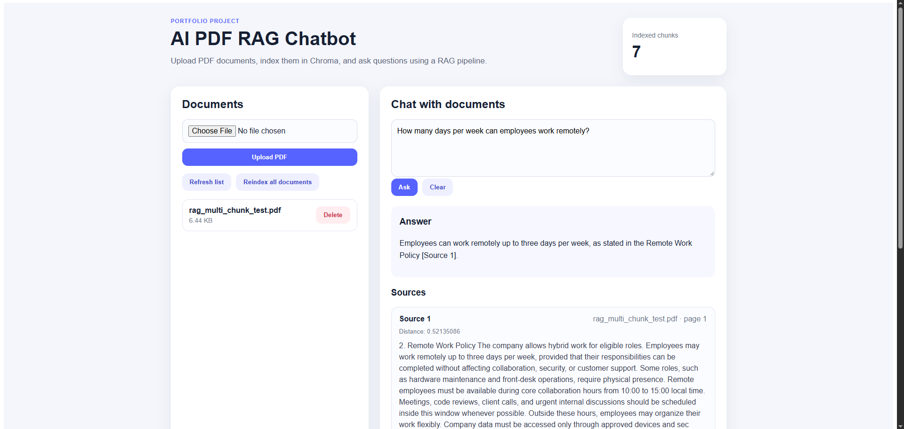

# AI PDF RAG Chatbot

A full-stack application for uploading PDF documents and asking questions about their contents using **Retrieval-Augmented Generation (RAG)**. The application retrieves relevant passages from the uploaded PDFs and uses a configurable answer provider: **Ollama** (local), **OpenAI**, or a lightweight **mock mode** for development.

Built with **Angular**, **FastAPI**, **ChromaDB**, and **Docker Compose**.

## Application Preview



## Features

- Upload PDF files and extract their text with PyMuPDF.
- Split extracted text into chunks and index them in ChromaDB.
- Ask questions about the indexed documents.
- View retrieved source passages, including filename and page number.
- List and delete uploaded PDFs.
- Rebuild the document index from uploaded PDFs.
- Switch between Ollama, OpenAI, and mock answer providers through environment variables.
- Run the backend and vector database with Docker Compose.


## Tech stack

| Layer | Technology |
| --- | --- |
| Frontend | Angular, TypeScript, SCSS |
| Backend / API | Python, FastAPI |
| PDF extraction | PyMuPDF |
| Vector search | ChromaDB |
| Answer generation | Ollama / OpenAI / mock mode |
| Containers | Docker Compose |

## How it works

```text
PDF upload
    |
    v
FastAPI -> PyMuPDF -> Text chunking -> ChromaDB index
                                          |
User question -> Angular -> FastAPI -> ChromaDB search
                                          |
                                          v
                                   Retrieved chunks
                                          |
                                          v
                                 Ollama / OpenAI / Mock
                                          |
                                          v
                             Answer + source references
                                          |
                                          v
                                        Angular
```

The current implementation uses ChromaDB's embedding functionality to vectorize document chunks and search queries. **Ollama/OpenAI are used to generate answers**.

## Project structure

```text
ai-pdf-rag-chatbot/
├── backend/
│   ├── Dockerfile
│   ├── requirements.txt
│   └── app/
│       ├── main.py
│       ├── uploads/
│       └── services/
│           ├── pdf_service.py
│           ├── chunking_service.py
│           ├── vector_store_service.py
│           └── rag_service.py
├── frontend/
├── docker-compose.yml
├── .env.example
└── README.md
```

## Prerequisites

- Docker Desktop with Docker Compose
- Node.js and npm (for Angular)
- Ollama installed and running **if using the local LLM option**
- An OpenAI API key with API access **if using the OpenAI option**

## Setup

### 1. Clone and configure

```bash
git clone <your-repository-url>
cd ai-pdf-rag-chatbot
```

Create an environment file from the template:

**PowerShell (Windows):**

```powershell
Copy-Item .env.example .env
```

**macOS / Linux:**

```bash
cp .env.example .env
```

Example `.env` for Ollama:

```dotenv
USE_MOCK_LLM=false
LLM_PROVIDER=ollama
OLLAMA_BASE_URL=http://host.docker.internal:11434
OLLAMA_MODEL=qwen3:8b
OPENAI_API_KEY=
CHROMA_HOST=chroma
CHROMA_PORT=8000
```

Provider settings:

| Mode | Settings | Additional requirements |
| --- | --- | --- |
| Ollama | `LLM_PROVIDER=ollama`, `USE_MOCK_LLM=false` | Running Ollama server and downloaded model |
| OpenAI | `LLM_PROVIDER=openai`, `USE_MOCK_LLM=false` | Set `OPENAI_API_KEY` |
| Mock | `LLM_PROVIDER=mock`, `USE_MOCK_LLM=true` | No LLM service or API key required |

**Ollama setup:**

```bash
ollama pull qwen3:8b
ollama list
```

Ensure the Ollama application/server is running on the host at `http://localhost:11434`.

> When FastAPI runs in Docker and Ollama runs on your computer, the backend uses `http://host.docker.internal:11434`. If this hostname does not resolve in your Docker setup, add the following under the `backend` service in `docker-compose.yml`:
>
> ```yaml
> extra_hosts:
>   - "host.docker.internal:host-gateway"
> ```
>
> The Ollama service must also be reachable from the container. Avoid exposing Ollama to untrusted networks.

### 2. Start backend and ChromaDB

From the project root:

```bash
docker compose up --build
```

- FastAPI docs: http://127.0.0.1:8000/docs
- Backend API: http://127.0.0.1:8000
- ChromaDB host port: `8001` (internal container port: `8000`)

### 3. Start Angular

In a separate terminal:

```bash
cd frontend
npm install
npm start
```

If your `package.json` does not define a `start` script, use `npx ng serve` instead.

Open **http://localhost:4200**.

## Using the app

1. Upload a PDF in the **Documents** section.
2. Wait for processing and indexing to finish.
3. Enter a question in **Chat with documents** and select **Ask**.
4. Review the response and its retrieved source passages.
5. Delete PDFs or select **Reindex** to rebuild the index when needed.

Example question for the provided policy-style test document:

> How many days per week can employees work remotely?

Actual answers depend on the content of your uploaded PDFs and the selected answer provider.

## Main API endpoints

| Method | Endpoint | Purpose |
| --- | --- | --- |
| `GET` | `/documents` | List uploaded PDFs |
| `POST` | `/documents/upload` | Upload and index a PDF |
| `DELETE` | `/documents/{filename}` | Delete a PDF and reindex |
| `POST` | `/documents/reindex` | Rebuild ChromaDB index |
| `POST` | `/chat` | Ask a question about indexed PDFs |
| `GET` | `/search?query=...` | Inspect retrieved chunks |
| `GET` | `/debug/chunks/count` | Count indexed chunks |

Example `POST /chat` body:

```json
{
  "question": "How many days per week can employees work remotely?"
}
```

The response contains the answer and retrieved source details; the implementation may also expose a `has_answer` flag.
